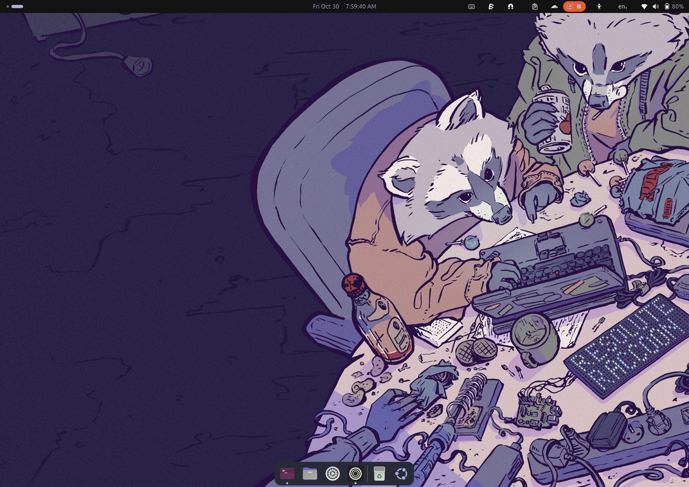
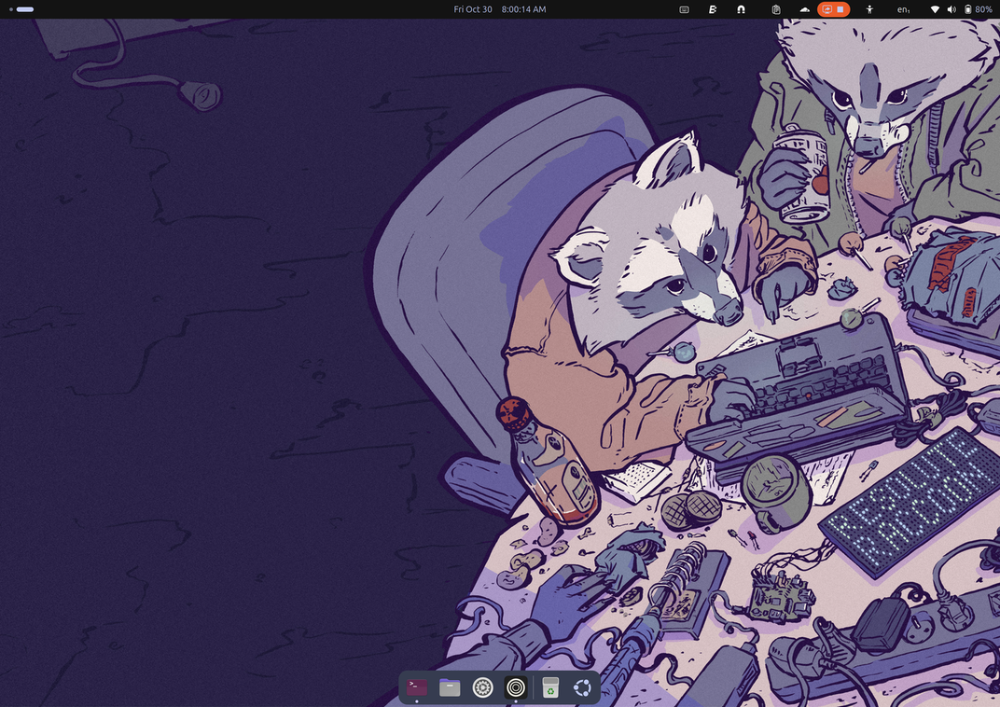
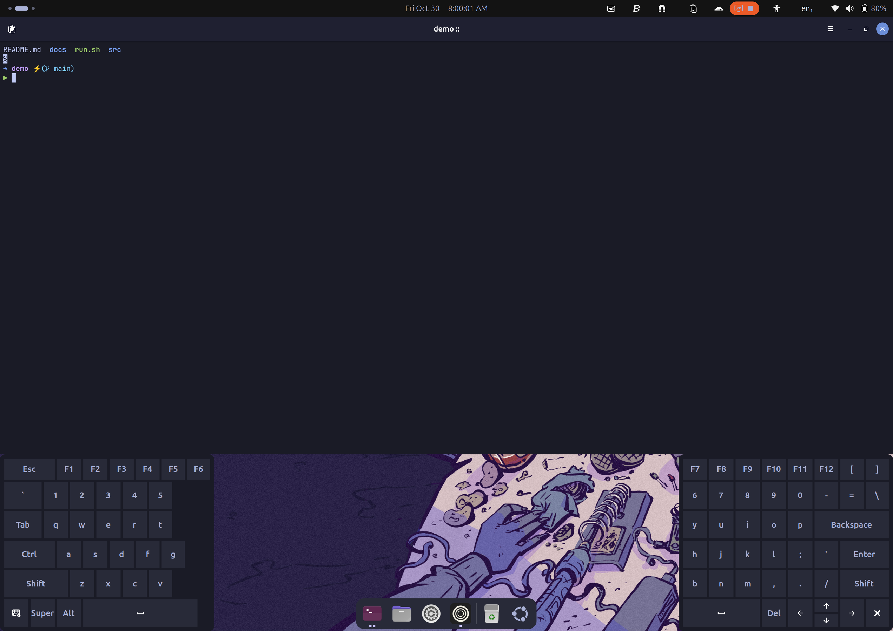
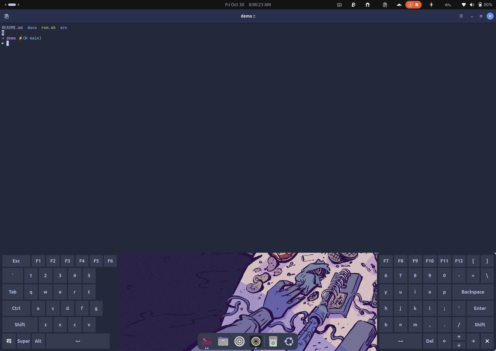
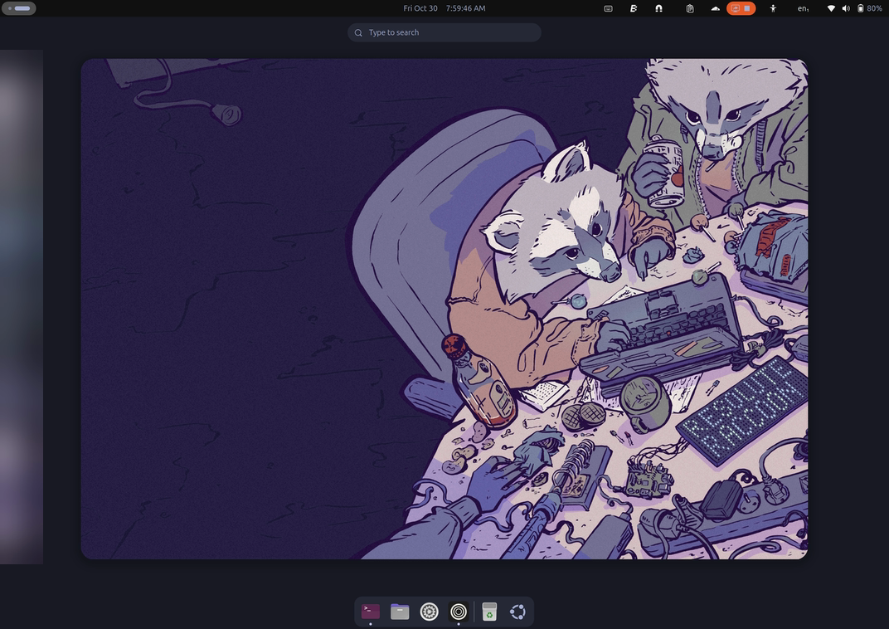
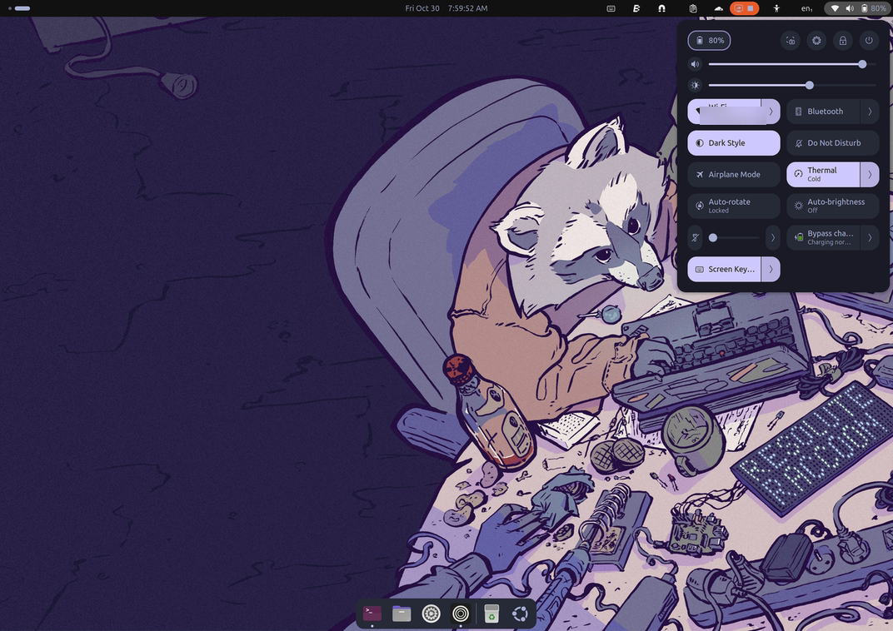
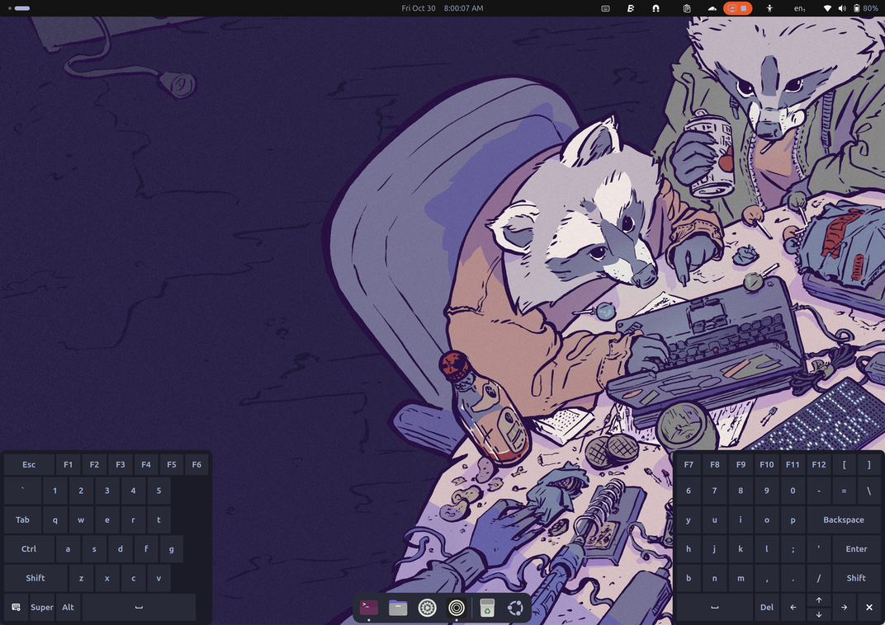

# tokyonight-ubuntu

[](https://github.com/nadelacruz-00/tokyonight-ubuntu/actions/workflows/ci.yml)

One command to give an Ubuntu 26.04 (aarch64) GNOME desktop the Rewaita Tokyo Night look: GTK, Shell, terminal, prompt, on-screen keyboard and, optionally, the GDM login screen. Every change is backed up and `--uninstall` undoes it.

## What you get

| Tokyo Night | Tokyo Night Storm |
|---|---|
|  |  |
|  |  |

| Activities overview | Quick Settings |
|---|---|
|  |  |

| GJS OSK split keyboard |
|---|
|  |

The GDM login screen (a `--system` change) is not pictured: it cannot be captured from a user session.

## Requirements

- Ubuntu 26.04, aarch64, GNOME on a running session (Wayland or X11). Other systems are refused unless you pass `--force`.
- Never run as root. The root-level parts ask for `sudo` only with `--system`.
- Required tools: `dconf`, `sha256sum`, `install`, `flock`, `python3`, `curl`, and a session D-Bus (or `dbus-run-session`).
- Optional, per module: `flatpak` (Rewaita), the `user-theme` shell extension, the Ubuntu 26.04 wallpapers package, Ptyxis, zsh or bash, and the GJS OSK extension. A module whose prerequisite is missing is skipped with a hint; `--system` installs the apt-installable ones.
- Disk: about 200 MB free. Network: fonts, oh-my-posh and the Rewaita flatpak are downloaded (checksum verified) unless you use `--offline` with a warm cache.

## Quick start

```sh
git clone --recursive https://github.com/nadelacruz-00/tokyonight-ubuntu
cd tokyonight-ubuntu
./install.sh
```

Then, for the parts that need root (apt packages, the GDM login theme, the OSK split-flush hook on erhai):

```sh
./install.sh --system
```

Try it first with `./install.sh --dry-run`; check what is applied with `./install.sh --status`. Log out and back in afterwards so GNOME Shell loads new extensions and the shell theme.

## Options

| Flag | Meaning |
|---|---|
| `--variant tokyonight\|storm` | colour variant (default: `tokyonight`) |
| `--system` | also run the root-level parts (uses `sudo`) |
| `--only a,b` | run only these modules |
| `--skip a,b` | run every module except these |
| `--dry-run` | show what would change, change nothing |
| `--status` | per module: applied, drifted (n) or n/a |
| `--uninstall` | undo every install, newest first |
| `--backup TS` | with `--uninstall`: undo only backup `TS` |
| `--purge` | with `--uninstall`: also remove the flatpak app, fonts and oh-my-posh binary installed by us |
| `--offline` | use the download cache only |
| `--strict` | stop at the first module failure |
| `--force` | continue on an unsupported OS, architecture or desktop |
| `-y`, `--yes` | do not ask for confirmation |
| `-v`, `--verbose` | show debug messages |
| `-h`, `--help` | show the help |
| `--version` | print the version |

Modules, in order: `fonts rewaita gtk shell-theme wallpaper ptyxis prompt osk gdm`.
Exit status: 0 ok, 1 a module failed (or the confirmation was declined), 2 usage error, 3 preflight failed, 4 another install is running, 130 interrupted.

## What each module changes

Settings are written with dconf; files are copied only when they differ. Re-running changes nothing.

| Module | Changes |
|---|---|
| `fonts` | JetBrainsMono Nerd Font (pinned release) into `~/.local/share/fonts/JetBrainsMonoNerd`, then `fc-cache`. |
| `rewaita` | Installs the Rewaita flatpak (user install, from Flathub) and merges its `prefs.json` (`~/.var/app/io.github.swordpuffin.rewaita/data/prefs.json`): Tokyo Night or Storm dark theme, blue accent, GTK 3 and Shell modification on. Needs flatpak (`--system` installs it). |
| `gtk` | `~/.config/gtk-4.0/gtk.css` and `~/.config/gtk-3.0/gtk.css` (Rewaita-generated); `color-scheme` `prefer-dark`, `accent-color` `purple`, `gtk-theme` and `icon-theme` `Yaru-purple-dark`. |
| `shell-theme` | `~/.local/share/themes/rewaita/gnome-shell/gnome-shell.css`; enables `user-theme@gnome-shell-extensions.gcampax.github.com` and selects the `rewaita` shell theme. Needs the extension (`--system` installs `gnome-shell-extensions`). |
| `wallpaper` | The Ubuntu 26.04 "Ask a friend" wallpaper for desktop (light and dark) and lock screen, `zoom`. Needs `ubuntu-wallpapers-resolute` (`--system` installs it). |
| `ptyxis` | Palette "Tokyo Night" or "Tokyo Night Storm" on the default profile (a "Tokyo Night" profile is created only if none exists), font `JetBrainsMono Nerd Font 10`, dark interface. |
| `prompt` | oh-my-posh to `~/.local/bin` (kept if 31.8.0 or newer is installed), config to `~/.config/oh-my-posh/tokyonight_storm.omp.json`, a marked init block in `~/.zshrc` and `~/.bashrc`; the zellij theme `tokyo-night-storm` and the lig theme `tokyonight` when those are installed. |
| `osk` | The `gjsosk-theme-sync` extension (colours the GJS OSK keyboard from the Rewaita palette), keyboard sizing, and a split layout built for your active keymap. Needs the GJS OSK extension. On erhai with `--system`: the split-flush apt hook. |
| `gdm` | `--system` only. Builds a GDM theme (erhai or Yaru base, the wallpaper, Tokyo Night colours) into `/usr/share/gnome-shell/theme/tokyonight-ubuntu/` and registers it as the `gdm-theme.gresource` alternative (priority 160). Applies at the next GDM start. |

Backups and the install state live in `~/.local/state/tokyonight-ubuntu/`.

## Uninstall

```sh
./install.sh --uninstall                  # undo every install, newest first
./install.sh --uninstall --system         # also undo the root-level changes (asks for sudo)
./install.sh --uninstall --backup TS      # only backup TS (see the state directory)
./install.sh --uninstall --purge          # also remove the flatpak, fonts and oh-my-posh we installed
```

Files and settings go back to what they were before each run. Root-level changes (the GDM theme, the OSK split-flush hook) are undone only with `--uninstall --system`; without it the uninstall tells you to re-run with `--system` and keeps that backup pending. Packages installed with `--system` (apt) are kept.

`--purge` can be run later: after a plain `--uninstall`, a second `./install.sh --uninstall --purge` removes the flatpak, fonts and oh-my-posh binary we installed. `--purge --backup TS` replays only that backup, so it purges only what that run installed.

## erhai / OnePlus Pad 3 extras

On an erhai image (detected from its GDM theme or the `oneplus-erhai-desktop` package) the OSK module also installs, with `--system`, a split-flush patch for GJS OSK: `/usr/local/sbin/gjsosk-split-flush` plus an apt hook that re-applies it whenever the extension package is upgraded. The GDM module builds on the erhai GDM theme when present. Nothing else differs.

## Troubleshooting

- **Nothing changed after install.** Log out and back in; new extensions and the shell theme load only at login.
- **Extensions on Wayland.** GNOME Shell cannot load a newly installed extension without a new session. The install logs "log out and back in to load new extensions".
- **"No session bus".** Preflight fails when there is no `DBUS_SESSION_BUS_ADDRESS` and no `dbus-run-session`. Run from a desktop session, or inside `dbus-run-session`.
- **Flathub offline / no network.** The `rewaita` module is skipped with `--offline` or fails without a network; fonts and prompt need their cached downloads. Re-run with a connection. The other modules do not need one.
- **OSK split layout missing.** The layout is built from a keycode cache that GJS OSK writes the first time you open it. Open the on-screen keyboard once, then run `./install.sh --only osk` again.
- **A module says "n/a" in `--status`.** Its prerequisite is missing; the message says which and whether `--system` can install it.
- **Anything else.** Run with `-v`, or `--dry-run` to see the plan.

## Regenerating assets

The Rewaita CSS under `assets/rewaita/` is vendored. A maintainer with a desktop that has the Rewaita flatpak regenerates it, and the checksum list, with `tools/regen-assets.sh`; it restores every file Rewaita touches. `assets/SOURCES.md` lists where each file comes from and `assets/checksums.sha256` pins them.

The screenshots above are captured by a maintainer in a live session with `tools/screenshots.sh [--variant tokyonight|storm] [--delay N] desktop|overview|quick-settings|ptyxis|osk`. Run from a terminal, use `--delay`, which counts down instead of waiting for Enter so you can minimise the terminal and open the menu first, e.g. `tools/screenshots.sh --delay 10 quick-settings`. To take every shot in one go without any prompt, run `tools/screenshots.sh --auto --with-storm`: one countdown (10 s, `--delay N` to change it) to minimise the terminal, then each shot opens what it needs (overview, Quick Settings, demo terminal, on-screen keyboard), captures and closes it again; `--with-storm` then switches to Tokyo Night Storm with Rewaita for the Storm desktop and terminal shots and restores the theme files and settings byte-for-byte afterwards (also on failure or Ctrl+C). Add shot names to `--auto` to take only those. The terminal shot runs in a sanitised environment, the files are stripped of PNG metadata and scanned for personal data.

## Development & tests

```sh
make dev-deps          # one-off: shellcheck, shfmt, ruff in .venv-dev
make test              # lint, PII scan, Python unit tests, bats, GJS tests
make test-integration  # real install.sh and dconf in a temp HOME on a private bus
make test-container    # the same in an Ubuntu 26.04 container, with --system
```

CI runs on every push (`.github/workflows/ci.yml`). `make pii` scans the tree for personal identifiers; it must stay clean.

## Credits & licences

See [CREDITS.md](CREDITS.md): Rewaita, Tokyo Night (folke), oh-my-posh, Nerd Fonts, GJS OSK and Gogh. Vendored files and their licences are listed in `assets/SOURCES.md`.

## License

GPL-3.0, see [LICENSE](LICENSE).
